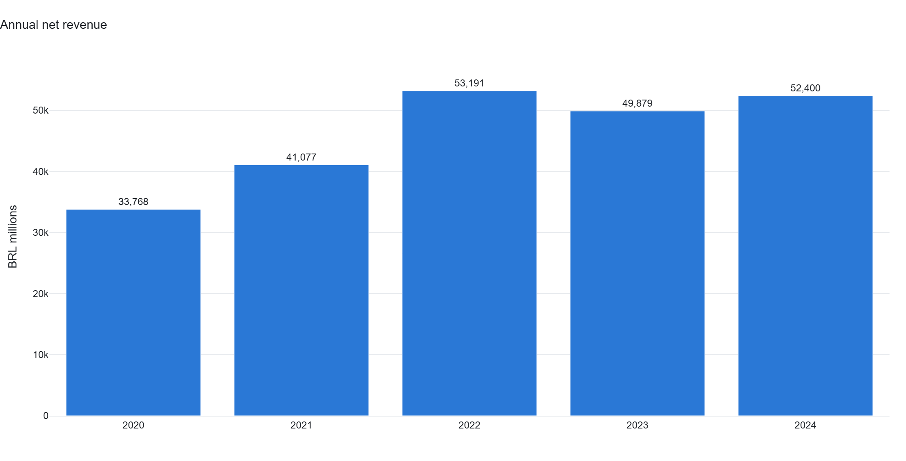
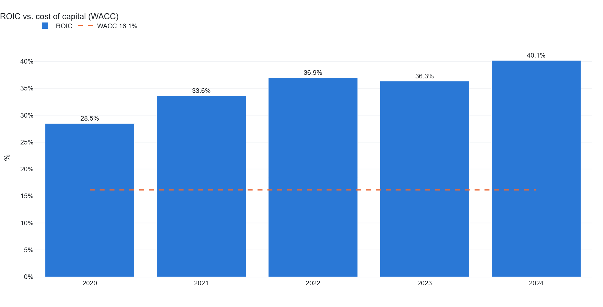
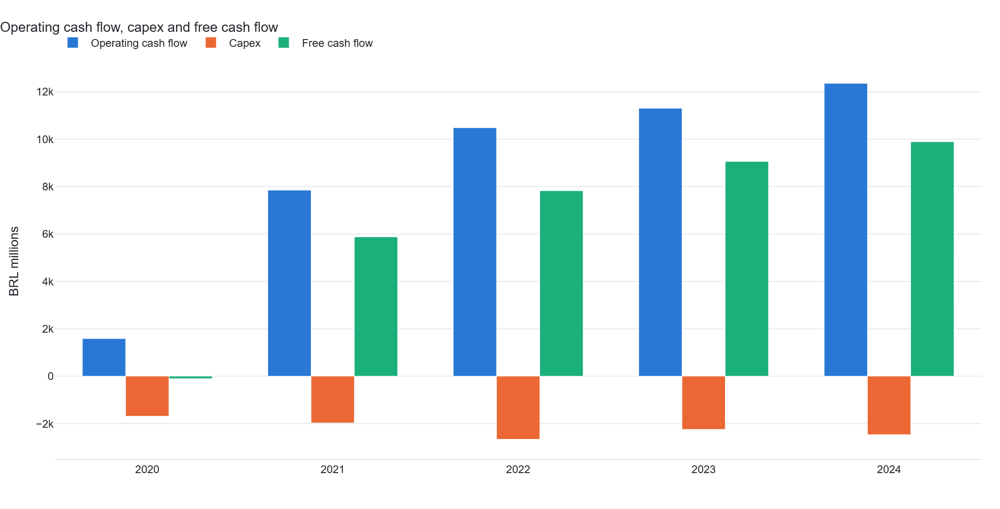

# WEG Equity Pipeline

Pipeline de análise fundamentalista da **WEG S.A. (WEGE3.SA)** na B3: ETL de demonstrações
da **CVM** e preços do **Yahoo Finance**, KPIs, **DCF com sensibilidade Selic × câmbio**,
dashboard em Streamlit e relatório estático.

[](https://github.com/sergiomeyer23/weg_equity_pipeline/actions/workflows/ci.yml)
[](https://www.python.org/)
[](https://streamlit.io/)

> **Aviso:** os dados do modo `--mock` são sintéticos e servem apenas para demonstrar o
> pipeline. Nada aqui é recomendação de investimento.

---

## O que o projeto faz

- **ETL:** baixa as DFPs anuais da CVM, extrai receita, EBIT, lucro, dívida, caixa e fluxo
  de caixa; complementa com preços do Yahoo Finance. FMP/Brapi são opcionais.
- **KPIs:** margens (bruta, EBIT, líquida), ROIC, alavancagem (dívida/PL e dívida líquida/PL),
  FCF e FCF yield.
- **DCF:** projeção explícita de 5 anos, WACC por CAPM, crescimento na perpetuidade e
  sensibilidade a **Selic** e **USD/BRL**.
- **Dashboard:** visão anual, margens, ROIC vs. WACC, alavancagem, fluxo de caixa, FCF yield,
  receita por origem, preço e drawdown.
- **Relatório estático:** exporta as mesmas figuras em PNG/HTML e tabelas em CSV.
- **Testes:** DCF validado contra cálculo manual, regressões de dívida/FX/FCF e checagem de
  dados reais da CVM (quando o ETL live foi executado).

---

## Como rodar

```bash
# 1. Dependências
pip install -r requirements.txt

# 2. Dados sintéticos (offline, não são dados reais da WEG)
python -m src.etl.ingestion --mock

# 3. Dashboard
streamlit run app.py

# 4. Relatório estático (PNG/HTML + CSV)
python generate_report.py

# 5. Testes
pytest -q
```

Para dados reais:

```bash
python -m src.etl.ingestion --live
```

O modo `--live` acessa a CVM e o Yahoo Finance; não precisa de chave de API. O modo `--mock`
usa `tests/fixtures/` e permite rodar tudo sem internet.

### Saídas

- `data/processed/` — parquets normalizados (não versionados).
- `outputs/figures/` — PNG + HTML interativo.
- `outputs/tables/` — tabelas em CSV.

---

## Resultados (dados sintéticos do modo `--mock`)

As imagens abaixo são geradas pelo próprio pipeline e servem para mostrar o formato das
análises — **não** representam a WEG real.

| Receita anual | ROIC vs. WACC |
|---|---|
|  |  |

| Fluxo de caixa livre |
|---|
|  |

O FCF é derivado de **OCF menos capex** (PP&E + intangíveis), porque a CVM não publica uma
linha pronta de "Free Cash Flow". O gráfico de caixa usa a mesma função do relatório e do
dashboard, evitando números diferentes para a mesma métrica.

---

## Metodologia

### Dívida e ROIC

A CVM repete os rótulos `Empréstimos e Financiamentos` e `Debêntures` no passivo circulante
(`2.01`) e no não circulante (`2.02`). O ETL desambigua os rótulos pelo código da conta antes
do pivot; o total de dívida soma as duas parcelas. Se a base antiga tiver apenas o rótulo
colapsado, o código usa o fallback legado.

```
ROIC = NOPAT / (dívida total - caixa + patrimônio líquido)
```

### DCF

- Projeção de receita com crescimento decrescente e margem EBIT estável.
- NOPAT = EBIT × (1 - taxa efetiva).
- FCFF = NOPAT + D&A - capex - variação de capital de giro.
- WACC = Ke × (1 - D/V) + Kd × (1 - t) × D/V.
- Valor terminal por Gordon: FCFF × (1 + g) / (WACC - g).
- **Câmbio:** o USD/BRL ajusta o **nível** da receita internacional uma única vez; não é
  aplicado como crescimento composto em todos os anos.
- Sensibilidade: grade Selic × USD/BRL e tornado chart por driver.

O DCF é uma ferramenta de **cenários**, não um preço-alvo. Pequenas mudanças em WACC,
crescimento perpétuo ou margem movem o resultado de forma relevante.

---

## Estrutura

```text
weg_equity_pipeline/
├── app.py                      # Dashboard Streamlit
├── generate_report.py          # Relatório estático (PNG/HTML + CSV)
├── config/settings.yaml        # WACC, Selic, câmbio e janela de análise
├── src/
│   ├── etl/
│   │   ├── ingestion.py        # Orquestra CVM + Yahoo (+ FMP/Brapi)
│   │   ├── transform.py        # Long → wide, limpeza de preços
│   │   └── clients/            # Clientes CVM, Yahoo, FMP, Brapi
│   ├── analytics/
│   │   ├── kpis.py             # Margens, ROIC, alavancagem, FCF
│   │   ├── valuation.py        # DCF, sensibilidade, tornado
│   │   └── market.py           # Preço, retorno, drawdown
│   ├── viz/charts.py           # Gráficos Plotly
│   ├── report.py               # Cálculos compartilhados
│   └── data.py                 # Carregamento dos parquets
├── tests/                      # Testes de DCF, KPIs e dados CVM
├── docs/                       # Screenshots do README
└── requirements.txt
```

---

## Limitações

- **CVM:** o parser depende dos rótulos e códigos de conta da DFP. Mudanças de layout podem
  exigir ajuste no mapeamento; o teste com dados reais é pulado quando o ETL live não rodou.
- **Dívida:** arrendamentos e outras obrigações financeiras podem não estar no mesmo rótulo;
  confira a composição no formulário original antes de usar o número em produção.
- **DCF:** assume margem e crescimento constantes no horizonte; não modela ciclos, dividendos,
  recompras ou mudanças de estrutura de capital.
- **Dados de mercado:** Yahoo Finance pode ter falhas, atrasos ou ajustes de proventos.
- **Mock:** os dados sintéticos existem para testar o pipeline, não para analisar a WEG.

---

## Licença

Código sob [MIT](LICENSE). Dados da CVM são públicos; preços do Yahoo Finance seguem os termos
do provedor. Este projeto não é recomendação de investimento.
