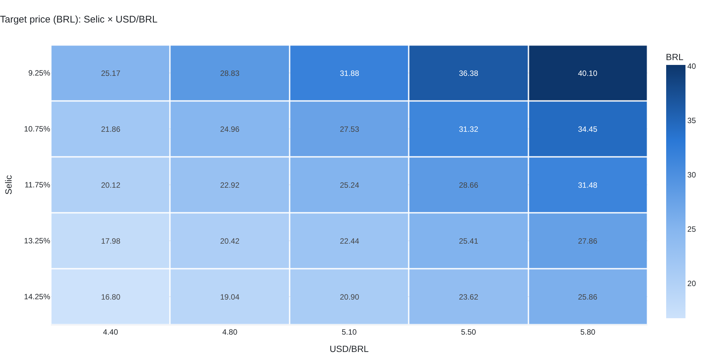
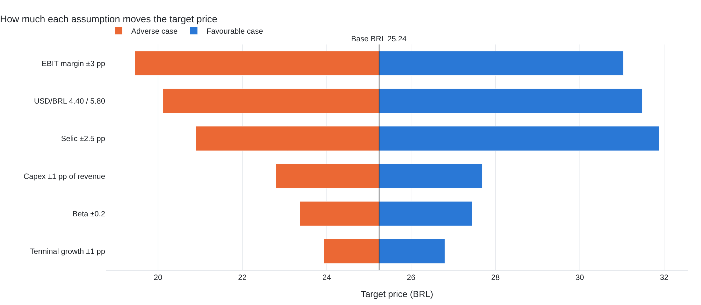

# WEG S.A. (WEGE3.SA) — Fundamental Analysis Pipeline

B3 | Industrials — Electrical Equipment | BRL

Automated equity research pipeline for WEG S.A. Extracts 5 years of pricing and
statement data, computes corporate KPIs, runs a DCF valuation, and exposes a
Streamlit dashboard with Selic × BRL/USD sensitivity.

## Quick start

```bash
pip install -r requirements.txt
pytest tests/
```

## 📊 Interactive dashboard

```bash
python -m src.etl.ingestion --mock     # synthetic data (offline)
# or: python -m src.etl.ingestion --live   # official data (CVM + Yahoo Finance)
streamlit run app.py
```

Six tabs, with filters for **fiscal year** and **price window**, and DCF assumptions you can adjust in the
sidebar (EBIT margin, Selic, perpetuity growth, beta):

| Tab | Question it answers |
|-----|---------------------|
| 📈 Overview | Is revenue growing? Do margins keep up? How much comes from abroad? |
| 💰 Profitability | Does ROIC exceed the cost of capital (WACC)? |
| 🏦 Balance sheet & cash | Is the balance sheet sound? Does cash fund growth? |
| 🎯 Valuation (DCF) | What is the target price, the EV → equity bridge, the Selic × USD/BRL sensitivity, and which assumptions matter most? |
| 📉 Market | Price, moving averages, drawdown, annual returns, volatility |
| 🗂️ Data | Methodology, statements table and CSV download |

When the data comes from the fixture, the dashboard shows a **synthetic data** banner.

## 🖼️ Static report

```bash
python generate_report.py
```

Produces 14 figures (PNG + interactive HTML) in [`outputs/figures/`](outputs/figures) and summary
tables in [`outputs/tables/`](outputs/tables). PNG export needs Chrome for kaleido
(`plotly_get_chrome` or `BROWSER_PATH=/path/to/chrome python generate_report.py`).




## Project layout

- `src/etl/` — ingestion: yfinance, CVM open data and (optional, with an API key) FMP / Brapi
- `src/analytics/` — KPIs, DCF (+ tornado) and market statistics
- `src/viz/charts.py` — Plotly figures (colour-blind-validated palette, no dual axes)
- `src/data.py`, `src/report.py` — loading/unit normalisation and shared calculations
- `app.py` — Streamlit dashboard · `generate_report.py` — static figures and tables
- `tests/` — DCF vs. manual calculation, sensitivity direction and KPI sanity checks
  (skipped if the ETL has not run; the CVM reference test only runs on real data)
- `config/settings.yaml` — WACC, FX and Selic scenarios

## Data modes

- `--live`: prices from yfinance; statements from CVM / yfinance
- `--mock`: fully offline, synthetic prices and statements from `tests/fixtures/`

> Figures produced with `--mock` are synthetic and are **not** audited WEG results.
> This is not investment advice.
